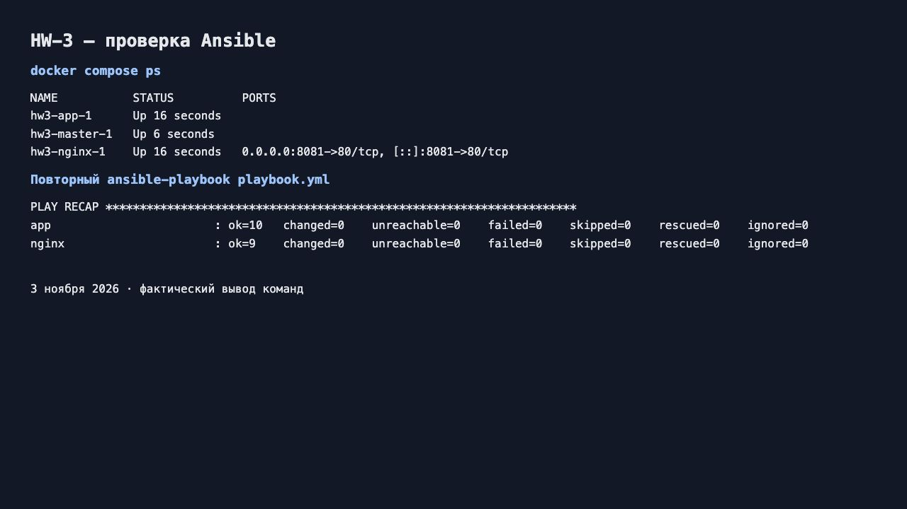
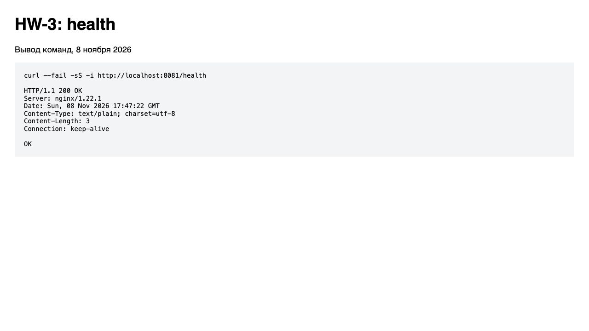

# HW-3 — Ansible

Три контейнера в сети `lab`:
- `master` — Ansible, запускает роли по SSH;
- `nginx` — чистый Debian с SSH и Python;
- `app` — такой же Debian для приложения.

Роль `app` проверяет зависимости, создаёт пользователя, распаковывает приложение
и запускает его shell-скриптом. Роль `nginx` устанавливает Nginx, копирует конфигурацию,
проверяет её командой `nginx -t` и запускает reverse proxy.
Playbook проверяет ОС и доступность `/health`.

## Запуск

Нужны Docker с Compose, `ssh-keygen` и `tar`. Команды из корня репозитория:

```sh
./setup.sh
docker compose up -d --build
docker compose exec master ansible-playbook playbook.yml
```

`setup.sh` создаёт локальный SSH-ключ и архив приложения. Они исключены из Git.
На целевые контейнеры передаётся только публичный ключ. SSH-порты наружу не открыты.
При первом соединении мастер запоминает ключи серверов (`accept-new`).

## Проверка

```sh
docker compose ps
curl --fail -i http://localhost:8081/health
curl --fail http://localhost:8081/
docker compose exec master ansible-playbook playbook.yml
```

Ожидаются HTTP 200 и `OK`. Повторный playbook не должен менять серверы (`changed=0`).
Исходники приложения: `HW_3/app/main.py`, скрипт запуска: `HW_3/app/start.sh`.
На хост опубликован только порт `8081`, внутри контейнера Nginx слушает `80`.
Приложение запускается от пользователя `app`, слушает `8080` внутри сети.

Обычный `docker compose restart` сохраняет установленное ПО и запускает сервисы снова.
После `docker compose down` контейнеры удаляются: для новой чистой установки повторите
`docker compose up -d --build` и playbook. Если пересоздавались только целевые контейнеры,
пересоздайте также `master`, чтобы его сохранённые SSH host keys соответствовали новым серверам.

При отдельной установке Compose используйте `docker-compose` вместо `docker compose`.

## Скриншоты

Фактический вывод команд после деплоя и перезапуска контейнеров, 3 ноября 2026.



