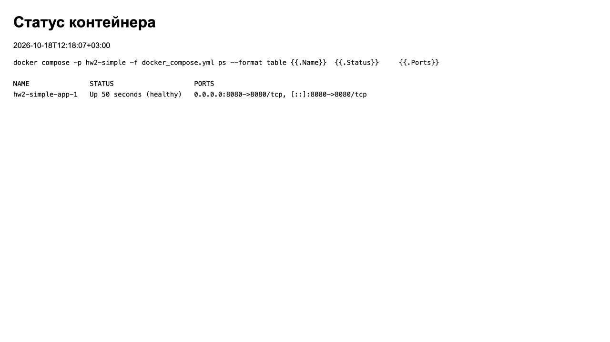

# Лабораторная 2

Требования: Git, Docker Compose v2, curl. Порт 8080 свободен.

## Сборка и запуск

```sh
git clone --branch HW-2 --single-branch https://github.com/rorororom/MIPT-SberTech-Labs.git lab2
cd lab2/HW_2
docker compose -f docker_compose.yml up -d --build --wait
```

## Проверка

Откройте http://localhost:8080 — «Приложение работает».

```sh
docker compose -f docker_compose.yml ps
curl --fail -i http://localhost:8080/health
```

Результат: контейнер `healthy`, HTTP 200, `{"status":"UP"}`.

## Остановка

```sh
docker compose -f docker_compose.yml down
```

## Публикация образа

```sh
docker login ghcr.io
IMAGE=ghcr.io/YOUR_LOGIN/lab2 TAG=1.0.0 ./scripts/build-push.sh
```

## Скриншоты



